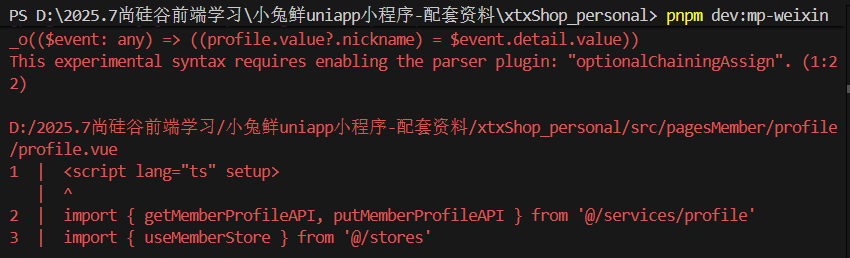

1、@change="" 里没有具体的方法，所以报错了
  - 
  - src\pagesMember\profile\profile.vue

2、语法错误
  - 可选链赋值”（obj?.name = '新值'）属于较实验性的语法，uni-app + Vite 编译到微信小程序时，底层解析器默认不认识它，所以直接报错了。
  - 
  - src\pagesMember\profile\profile.vue 昵称那行v-model,profile?.value = $event.target.value